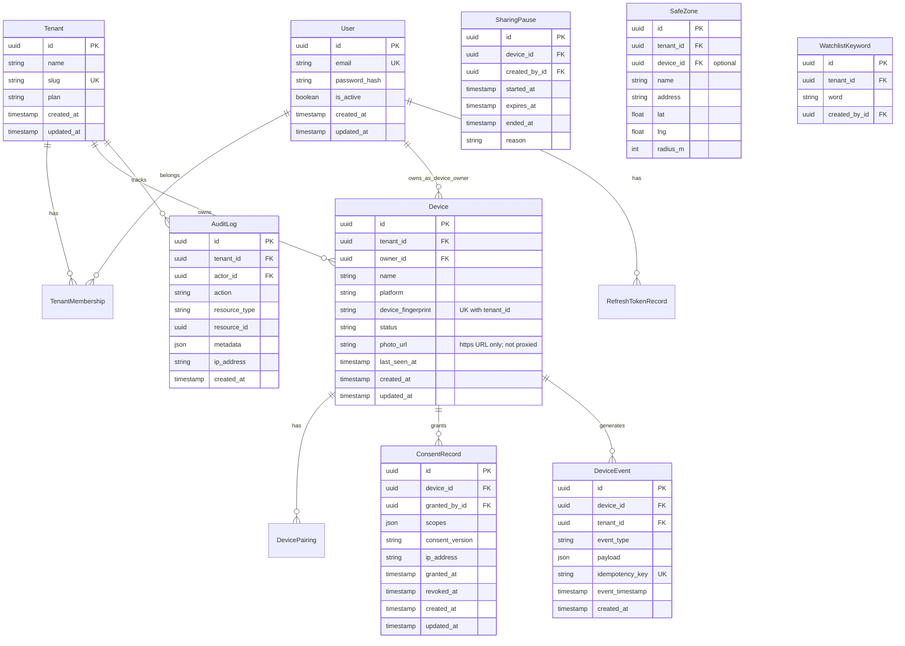

# Database Schema Design

> **Current database: MySQL 8+** (Docker Compose uses MySQL 8.4, `utf8mb4`). JSON columns are Django `JSONField` (MySQL `JSON`). PostgreSQL-specific features (JSONB, GIN, native partitioning, WAL/PITR) described below are **planned / not implemented** and only retained as design notes.

## Entity Relationship Overview



---

## Indexing Strategy

### `accounts_user`
- `UNIQUE (email)` — login lookup
- `INDEX (is_active, created_at)` — admin queries

### `devices_device`
- `INDEX (tenant_id, status)` — tenant device list
- `INDEX (owner_id)` — owner devices
- `UNIQUE (tenant_id, device_fingerprint)` — dedup

### `devices_consent_record`
- `INDEX (device_id, revoked_at)` — active consent lookup
- `scopes` is a JSON list; scope checks happen in application code (a GIN index is **planned / PostgreSQL-only, not implemented**)

### `events_device_event` (not partitioned today)
- `INDEX (device_id, created_at DESC)` — device timeline
- `INDEX (tenant_id, created_at DESC)` — tenant dashboard
- `UNIQUE (idempotency_key)` — dedup ingestion (nullable)
- `INDEX (event_timestamp)`
- `INDEX (event_type, created_at)` — analytics

### `audit_audit_log`
- `INDEX (tenant_id, created_at DESC)` — audit trail
- `INDEX (actor_id, created_at DESC)` — user activity
- `INDEX (resource_type, resource_id)` — resource history

---

## Partitioning Strategy — Planned / not implemented

`events_device_event` is currently a single regular MySQL table. The design below is the **target** (PostgreSQL syntax shown; a MySQL port needs `PARTITION BY RANGE` with `created_at` in every unique key, which conflicts with the current unique `idempotency_key`).

`events_device_event` — **RANGE partition by month** on `created_at`.

```sql
CREATE TABLE events_device_event (
    id UUID NOT NULL,
    device_id UUID NOT NULL,
    tenant_id UUID NOT NULL,
    event_type VARCHAR(64) NOT NULL,
    payload JSONB /* PostgreSQL target; MySQL uses JSON */ NOT NULL DEFAULT '{}',
    idempotency_key VARCHAR(128),
    created_at TIMESTAMPTZ NOT NULL DEFAULT NOW(),
    PRIMARY KEY (id, created_at)
) PARTITION BY RANGE (created_at);
```

Retention: 90 days hot → archive to S3 → drop partition.

---

## Read Replica Strategy — Planned / not implemented

- **Writes:** Primary only
- **Reads:** Dashboard list endpoints, analytics, reports → replica
- **Routing:** `django-db-replica` or custom database router in `core/infrastructure/db/router.py`

---

## Backup Strategy — Planned / not implemented

| Type | Frequency | Retention |
|------|-----------|-----------|
| Full backup | Daily | 30 days |
| WAL/PITR | Continuous | 7 days |
| Cross-region replica | Real-time | DR |

---

## Migration Strategy

1. All models use UUID primary keys
2. Migrations are forward-only in production
3. Destructive changes use expand-contract pattern
4. Partition creation automated via Celery monthly job (**planned**; Celery has no task modules yet)

---

## Implemented tables (current code)

| Table | Model | Notes |
|-------|-------|-------|
| `accounts_user` | `User` | Argon2 password hash, `full_name`, `is_active`, `last_login_ip` |
| `accounts_refresh_token` | `RefreshTokenRecord` | `jti` unique, `expires_at`, `revoked_at`, `replaced_by_jti`, ip/user-agent (simplejwt blacklist tables also installed) |
| `accounts_social_account` | `SocialAccount` | Google provider uid, unique per provider+uid |
| `tenants_tenant` | `Tenant` | `plan` free/pro/enterprise, `is_active` |
| `tenants_membership` | `TenantMembership` | `role`, unique (tenant, user) |
| `devices_device` | `Device` | `owner`, `platform`, `device_fingerprint`, `status`, `photo_url` (optional https), `last_seen_at`; unique (tenant, fingerprint) |
| `devices_pairing` | `DevicePairing` | One-to-one with device; `pairing_code`, `pairing_token`, `status`, `expires_at`, `completed_by` |
| `devices_consent_record` | `ConsentRecord` | `scopes` JSON list, `consent_version`, `granted_by`, `ip_address`, `granted_at`, `revoked_at` |
| `devices_sharing_pause` | `SharingPause` | Owner pause window (`started_at`, `expires_at`, `ended_at`); does not alter consent |
| `devices_safe_zone` | `SafeZone` | Tenant geofence: `name`, `address`, `lat`, `lng`, `radius_m`, optional `device` |
| `devices_watchlist_keyword` | `WatchlistKeyword` | Tenant keyword watchlist (`word`, `created_by`) |
| `events_device_event` | `DeviceEvent` | `event_type`, `payload` JSON (may include place/zone/contact fields), nullable unique `idempotency_key`, `event_timestamp` |
| `audit_audit_log` | `AuditLog` | `actor`, `action`, `resource_type`, `resource_id`, `metadata` JSON, ip, user_agent |
