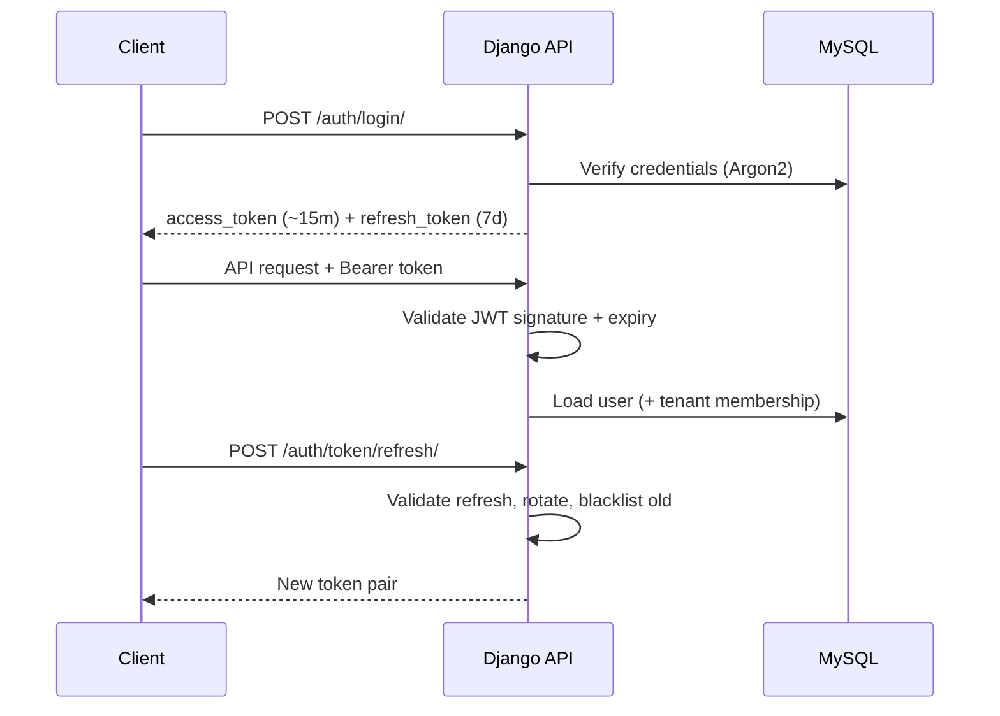

# Security Model

> **Status legend:** ✅ implemented in code · 🟡 partial · 📋 planned / not implemented.

## Implementation Status

| Control | Status | Notes |
|---------|--------|-------|
| Password hashing | ✅ | Argon2 (`Argon2PasswordHasher`) |
| JWT access token | ✅ | ~15 min (`JWT_ACCESS_TOKEN_LIFETIME_MINUTES`), simplejwt default signing (HS256 with `SECRET_KEY`) |
| Rotating refresh token + blacklist | ✅ | 7 days, `ROTATE_REFRESH_TOKENS`, `BLACKLIST_AFTER_ROTATION`, `token_blacklist` app |
| Google ID-token login | ✅ | `/auth/google/`, link via `/auth/link/google/` |
| Consent-gated event ingest | ✅ | Scope validated per event against active `ConsentRecord`; device must be active and owned by caller; `geofence.*` maps to `location` scope |
| Sharing pause | ✅ | Owner pause/resume blocks ingest/upload only; consent scopes unchanged |
| Device / contact photo URLs | ✅ | `https` only; server stores URL and never fetches (SSRF avoidance) |
| Pairing token + code | ✅ | Time-limited pairing (`expires_at`), QR `spylove://pair?code=&token=` |
| Monitor-chosen consent scopes | ✅ | `granted_by = device.owner`; revoke via `DELETE /devices/{id}/consent/` or disconnect |
| Audit log | 🟡 | `AuditLog` rows written for pairing/consent actions; readable via `GET /api/v1/audit/` by **owner/admin/monitor** (viewer gets 403); not enforced immutable |
| Tenant isolation | 🟡 | Monitor-side queries filter by the user's tenant membership |
| DRF throttling | ✅ | anon 20/min, user 100/min, auth 10/min, events 1000/min |
| Host / CORS allow-lists | ✅ | `ALLOWED_HOSTS` and `CORS_ALLOWED_ORIGINS` are env-driven CSV (`base.py`); allow-all CORS only in `settings/dev.py` |
| WebSocket auth + filtering | 🟡 | `Authorization: Bearer` preferred, `?token=` fallback (mobile limitation); expired/invalid tokens closed with 4001; `subscribe` filters delivery to the user's tenant devices. Query tokens can still leak into logs |
| Compose secrets | ✅ | MySQL/Grafana passwords come from env (`infra/.env.example`); defaults are local-dev only |
| Notification listener export | ✅ | `exported="true"` is required by Android for `NotificationListenerService`; protected by `BIND_NOTIFICATION_LISTENER_SERVICE` (documented in manifest) |
| Plan change without payment | 📋 | Owner/admin only; no billing/payment verification yet (TODO in `SubscribeView`) |
| RBAC permission matrix | 🟡 | Enforced for plan changes (`POST /subscription/subscribe/`: owner/admin) and audit log (owner/admin/monitor), plus device manage roles; the rest of the matrix below is not enforced end-to-end |
| RS256 JWT / key rotation | 📋 | |
| Field-level PII encryption | 📋 | |
| GDPR export / erasure endpoints | 📋 | `/users/me/export/` and `DELETE /users/me/` do not exist |
| mTLS / device certificates | 📋 | |
| Nginx `limit_req`, secure headers, WAF | 📋 | Deployment-level; verify `infra/nginx/nginx.conf` before relying on it |
| Dependabot / pip-audit in CI | 📋 | No CI pipeline in repo |

## Authentication Flow (Implemented)



Redis is not required for auth (optional cache only). Session metadata caching in Redis is **not implemented**.

## RBAC Matrix — Planned / not enforced

Target design; current code gates endpoints by authentication, device ownership and tenant membership rather than this matrix.

| Permission | Owner | Admin | Monitor | Viewer |
|------------|-------|-------|---------|--------|
| Manage tenant | ✓ | ✗ | ✗ | ✗ |
| Invite users | ✓ | ✓ | ✗ | ✗ |
| Initiate pairing | ✓ | ✓ | ✓ | ✗ |
| Complete pairing | ✓ | ✓ | ✓ | ✗ |
| Revoke consent | ✓ (owner device) | ✗ | ✗ | ✗ |
| Ingest events | ✓ | ✓ | ✓ | ✗ |
| View dashboard | ✓ | ✓ | ✓ | ✓ |
| View audit log | ✓ | ✓ | ✓ | ✗ |

## Device Authentication

**Implemented:**
1. Pairing code + token with expiry during pairing.
2. After pairing, the monitored device uses the owner's normal user JWT; `POST /events/batch/` requires `device_id` in the body and checks the device is active and owned by the caller. There is no `device_id` JWT claim.

**Planned:** mTLS device certificates stored in secure enclave.

## Data Protection

| Data Class | At Rest (current) | At Rest (planned) | Retention |
|------------|-------------------|-------------------|-----------|
| Credentials | Argon2 hash | — | Until deletion |
| PII (email, event payloads) | Plain MySQL columns | Encrypted columns | No automated purge today |
| Events | MySQL table (`events_device_event`) | Partitioned + archived, 90 days default | Planned |
| Audit logs | MySQL table | Append-only, 7 years | Planned |

Transport security (TLS) is a deployment concern handled outside the Django app.

## GDPR Controls — Planned / not implemented

- Right to access: `GET /api/v1/users/me/export/` (planned)
- Right to erasure: `DELETE /api/v1/users/me/` (planned)
- DPA: tenant-level flag (planned)
- **Implemented:** consent records keep history with `revoked_at`; data minimisation via rejection of events without consent scope.

## OWASP Top 10 Mapping

| Risk | Current | Planned |
|------|---------|---------|
| A01 Broken Access Control | Auth required, device ownership checks, tenant filtering | Full RBAC |
| A02 Cryptographic Failures | Argon2; JWT HS256 | RS256, TLS 1.3 hardening, field encryption |
| A03 Injection | Django ORM parameterization, DRF validation | — |
| A04 Insecure Design | Consent-first ingest | — |
| A05 Security Misconfiguration | Env-based settings (`.env` not committed) | Secure headers, DEBUG=False enforcement checks |
| A06 Vulnerable Components | — | Dependabot, pip-audit in CI |
| A07 Auth Failures | Throttling, token rotation, blacklist | Lockout policies |
| A08 Data Integrity | Idempotency keys on ingest | — |
| A09 Logging Failures | `AuditLog` for key actions | Structured logging, no PII in logs |
| A10 SSRF | `photo_url` / `contact_photo_url` validated as https and never fetched by the server | — |

## Rate Limiting

**Implemented:** DRF throttling (see API_DESIGN.md). **Planned:** Nginx `limit_req` tuning and Cloudflare rules in production.

## Secure Headers — Planned (production target)

```
Strict-Transport-Security: max-age=31536000; includeSubDomains; preload
X-Content-Type-Options: nosniff
X-Frame-Options: DENY
Content-Security-Policy: default-src 'self'
Referrer-Policy: strict-origin-when-cross-origin
```