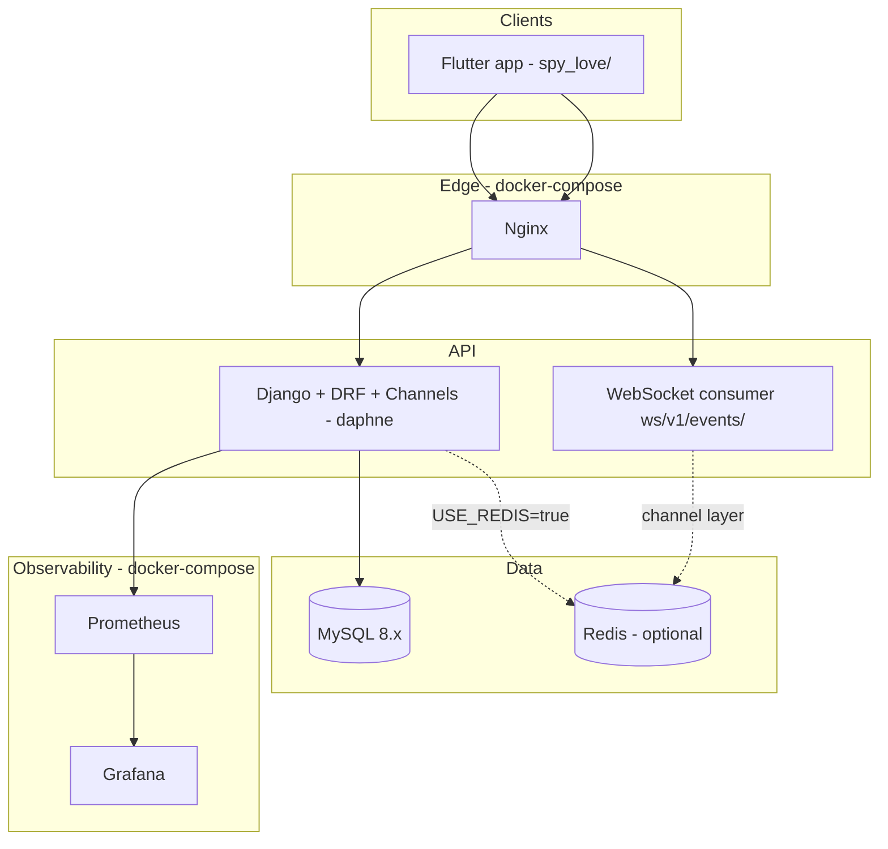

# Spy Love — Consent-Based Device Monitoring Platform

> **Status legend:** sections marked **Implemented** reflect the current code. Sections marked **Planned / not implemented** are target architecture and are kept as a roadmap only.

## Executive Summary

Consent-based device monitoring platform: a monitored device owner pairs a phone via QR/code, a monitor account approves a set of consent scopes, the phone uploads events in batches, and events are validated against the granted scopes, persisted, and pushed to the monitor over WebSocket.

**Scale targets (planned, not load-tested):** 10M+ users · 1M+ concurrent WebSocket connections · 100K+ events/sec · 99.99% uptime

---

## Current Architecture (Implemented)



Notes:
- Redis is optional. With `USE_REDIS=false` the cache is locmem, the channel layer is in-memory and Celery runs eager.
- Celery is wired (`config` app + `celery` service in `infra/docker-compose.yml`) but **no task modules exist yet**; nothing is dispatched to Celery today.
- There is **no separate web monitoring dashboard** yet. The Flutter app (`spy_love/`) contains both the monitored-device and monitor flows.
- Prometheus and Grafana are provisioned in `infra/docker-compose.yml`; OpenTelemetry/Loki are not.

## Backend Clean Architecture Layers (Implemented)

Each Django app under `backend/apps/` (`accounts`, `tenants`, `devices`, `events`, `audit`) is split into `presentation` / `application` / `infrastructure` (and `domain` where applicable); shared code lives in `backend/core/`.

```
┌─────────────────────────────────────────────────────────────┐
│  Presentation (DRF Views, Serializers, WebSocket Consumers)│
├─────────────────────────────────────────────────────────────┤
│  Application (Services / use cases)                          │
├─────────────────────────────────────────────────────────────┤
│  Domain (Entities, Value Objects, exceptions)                │
├─────────────────────────────────────────────────────────────┤
│  Infrastructure (Django ORM models, Redis, Celery, ext. APIs)│
└─────────────────────────────────────────────────────────────┘
```

**Dependency rule:** Inner layers never depend on outer layers.

---

## Multi-Tenancy Model (Implemented, partial)

| Model | Description |
|-------|-------------|
| `Tenant` | Workspace boundary (`plan`: free / pro / enterprise) |
| `TenantMembership` | User ↔ Tenant with role (unique per tenant+user) |
| `TenantScopedModel` | Base class with a `tenant` FK on devices, pairings, consent records, events and audit logs |

- API queries for monitor-side endpoints resolve the user's tenant through their membership (`AuthenticationService.get_user_tenant`). Tenant is **not** read from JWT claims.
- A monitored device is initially attached to a staging tenant owned by the device user, then attached to the monitor's workspace when pairing completes.
- Subscriptions: `POST /api/v1/subscriptions/subscribe/` sets the tenant plan directly. **No payment provider is integrated.**

---

## Consent Model (Implemented)

1. **Device owner** (signed-in user on the monitored phone) calls `POST /api/v1/devices/pair/initiate/` with `device_name`, `platform`, `device_fingerprint` and receives a pairing code and QR payload `spylove://pair?code=<code>&token=<token>`.
2. **Monitor** calls `POST /api/v1/devices/pair/complete/` with the pairing code and **chooses** the `consent_scopes` and `consent_version`.
3. A `ConsentRecord` is created with `granted_by = device.owner`, `ip_address`, `granted_at`; revocation sets `revoked_at`.
4. **Events** are rejected per-event if their scope is not in the active consent.
5. **Revoke / stop monitoring:** `DELETE /api/v1/devices/{id}/consent/` or `POST /api/v1/devices/{id}/disconnect/` (both revoke consent and disconnect the device).
6. Consent and pairing actions are written to the audit log (`GET /api/v1/audit/`).

Valid scopes (`VALID_CONSENT_SCOPES`): `location`, `battery`, `network`, `app_usage`, `device_info`, `notifications`, `call_log`, `sms`, `messaging`, `sim`.

**Collectors implemented in the Flutter app:** `location.update`, `call.log`, `sms.received`, `message.notification`, `sim.*`, `battery.status`, `network.status`, `app_usage.snapshot`, `device_info.snapshot`.

**Planned / not implemented:** in-place update of consent scopes (there is no `POST /devices/{id}/consent/`), consent version management UI/migrations, immutable (append-only enforced) audit storage.

---

## Real-Time Event Flow (Implemented)

```
Device → POST /api/v1/events/batch/ {device_id, events:[...]}
       → validate device ownership + active consent scope per event
       → bulk_create DeviceEvent (idempotency_key unique) + update last_seen_at
       → background threading.Thread → channel_layer.group_send("tenant_<id>_events")
       → Channels consumer (ws/v1/events/?token=<jwt>) → monitor app
```

- Batches are limited to 100 events; the response is `202 {accepted, rejected, errors[]}`.
- Broadcast is done from a daemon `threading.Thread`, **not** Celery.
- `device_events` is a regular (un-partitioned) MySQL table.

**Planned / not implemented:** Celery fan-out, Redis Pub/Sub cluster topology, monthly table partitioning, retention/archival to S3.

---

## Security Model

Implemented vs planned controls are detailed in [SECURITY_MODEL.md](SECURITY_MODEL.md). Summary:

| Layer | Implemented | Planned |
|-------|-------------|---------|
| Transport | TLS expected at Nginx/edge (deployment concern) | TLS 1.3 everywhere, HSTS preload |
| Auth | JWT access (~15m) + rotating refresh (7d) with simplejwt blacklist; Argon2; Google ID-token login | RS256 signing, device certificates / mTLS |
| API | DRF throttling, consent-gated ingest, tenant-scoped queries | Full RBAC permission matrix, per-device throttles |
| Data | Argon2 password hashes | Field-level PII encryption |
| Audit | `AuditLog` model + `GET /api/v1/audit/` | Immutable exports, SOC2 trail |

---

## Deployment Topology

- **Implemented (local / single-host):** `infra/docker-compose.yml` — MySQL 8.4, Redis 7, API (daphne), Celery worker, Nginx, Prometheus, Grafana. Local no-Docker dev uses MySQL + `runserver` with `USE_REDIS=false`.
- **Planned / not implemented:** DigitalOcean managed services, Kubernetes, read replicas, CDN/WAF, CI/CD. See [DEPLOYMENT_PLAN.md](DEPLOYMENT_PLAN.md).

### Target (Planned) topology

| Component | DO Service |
|-----------|------------|
| API | App Platform / Droplets + K8s |
| Database | Managed MySQL (HA) with read replicas |
| Cache | Managed Redis |
| Storage | Spaces (S3-compatible) |
| CDN/WAF | Cloudflare or DO CDN |
| Monitoring | Prometheus/Grafana (+ Loki, OpenTelemetry planned) |

---

## Implementation Roadmap

### Phase 1 — Foundation
- [x] Architecture documentation
- [x] Database schema & migrations
- [x] Core Django clean architecture scaffold
- [x] JWT auth (rotation + blacklist, Argon2, Google sign-in)
- [ ] Full RBAC permission matrix (roles exist on `TenantMembership`; not enforced as a matrix)
- [x] Docker Compose stack
- [x] Flutter app scaffold (`spy_love/`, `lib/app/modules/*`)

### Phase 2 — Core Features
- [x] Device pairing flow (QR + consent scopes chosen by monitor)
- [x] Event ingestion API with consent validation (`POST /api/v1/events/batch/`)
- [x] WebSocket real-time event stream (`ws/v1/events/`)
- [x] Audit logging (`AuditLog`, `GET /api/v1/audit/`)
- [ ] Separate web monitoring dashboard (not started; monitor UI is in the Flutter app)
- [x] Collectors for battery, network, app usage, device info

### Phase 3 — Scale & Reliability (Planned)
- [ ] Read replicas routing
- [ ] Event table partitioning
- [ ] Redis caching layer (Redis is optional today and used mainly as channel layer/cache backend)
- [ ] Celery background jobs (Celery wired, no tasks)
- [ ] Load testing (k6)

### Phase 4 — Production Hardening (Planned)
- [ ] OpenTelemetry tracing
- [~] Prometheus + Grafana provisioned in docker-compose; dashboards not documented
- [ ] CI/CD pipeline (GitLab)
- [ ] Multi-region failover design
- [ ] Disaster recovery runbooks

### Phase 5 — Compliance & Enterprise (Planned)
- [ ] GDPR data export/deletion
- [ ] Consent version management
- [ ] Payment-backed subscriptions (today `subscribe` just sets the plan)
- [ ] SOC2 audit trail exports
- [ ] Penetration test remediation

---

## API Versioning

Base path: `/api/v1/`

OpenAPI: `/api/v1/schema/` · Swagger UI: `/api/v1/docs/`